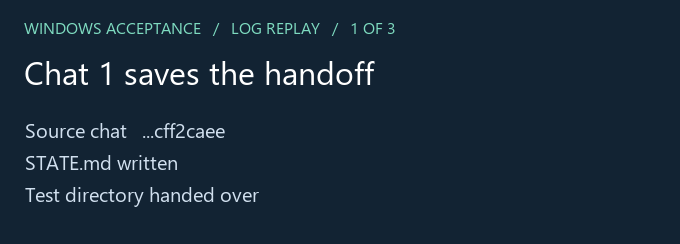

# Codex Auto Handoff

[English](README.md) · [文档索引](docs/index.md)

**Windows Codex Desktop 自动上下文交接与新聊天续接。** Codex 上下文快满时，助手保存任务状态，在同一已保存项目中创建带独立 ID 的新聊天并发送已授权的下一步。接续标题沿用原标题编号。

**安装**：把下面这句话发给 Codex。

```text
$skill-installer Install https://github.com/garwin925-wq/codex-auto-handoff/tree/main/codex-auto-handoff
```

**使用**：下一回合在原聊天里发送 `$codex-auto-handoff`。要让 Codex 自动换聊天，添加[全局规则](#设为默认)，并按需配置[上下文用量提醒](codex-auto-handoff/references/hooks.zh-CN.md)。

**Windows 11 已验收的能力**包括结构化检查点和同项目续接。原生工具可用时优先使用；Windows App Server 后备程序需要兼容的 Codex CLI 和 Node.js 20+，通过每个来源聊天独立的交接收据防止重复创建。



[Windows Codex 自动续接指南](docs/why-codex-auto-handoff.zh-CN.md) · [与 /compact 的区别](docs/codex-handoff-vs-compact.zh-CN.md)

**Windows 实测结果**：原聊天保存了交接文件，技能在同一项目中创建了新聊天，新聊天接着执行任务并写出了预期的验收值。另有一次[真实任务自然触发的记录](docs/natural-threshold-observation.zh-CN.md)：约 90.5% 时观察到提醒，新聊天完成了下一步。该记录来自本机部署，无法确认是否会在刚过 80% 时及时触发。[查看两次会话的步骤、结果与日志回放](docs/windows-acceptance.md)。

`/compact` 在原聊天内压缩上下文；本技能进行 fresh session handoff，新聊天有独立的聊天 ID，通过交接文件接着做。接续聊天沿用原标题并连续编号，例如「项目规划2」「项目规划3」。

## 什么时候换聊，什么时候用 `/compact`

如果还在追查一个故障，希望沿着当前讨论继续排查，可以用 `/compact` 压缩当前聊天。在一个阶段结束、能清楚写出下一步时，交接更有用。

例如，修复已经在本地通过，接下来要做 Windows 回归测试。交接时记下分支、未提交的文件、准确的测试命令和已有结果，再附上原测试计划的路径。新聊天可以在同一工作区打开原计划、核对改动，接着运行剩余测试。如果它开始重复已经做过的工作，你也可以直接核对交接文件。

写交接、读现场都需要时间。某个限制如果只在旧聊天里提过，交接时漏写，新聊天就可能错过它。换聊前应记下下一步依赖的决定，并结束或明确移交仍可能修改文件的工作。

## 安装

将仓库中的 `codex-auto-handoff/` 目录安装到用户 Codex 的 `skills/` 下。也可以把该目录的 GitHub 链接交给 Codex 的 skill-installer。新回合可使用 `$codex-auto-handoff`。

需要在没有原生创建工具时接续的用户，应安装 Node.js 20+ 并确保 Codex CLI 可用。备用程序使用实验性 App Server 协议，要求客户端提供项目归属、聊天创建和文件权限信息。实际工具和交互式审批能力因客户端而异。

## 设为默认

在用户级 `AGENTS.md` 的实际生效文件中加入：“有未完成工作且接近上下文上限、或即将产生大量输出时，使用 $codex-auto-handoff 在同一项目换聊，沿用已授权的下一步。”仅安装技能即可手动调用，开箱不会编辑用户配置。

可选的工具调用后提醒见 [用量提示配置](codex-auto-handoff/references/hooks.zh-CN.md)。读不到可靠用量时，由助手按阶段保存。工具调用后的检查不能保证在任意一次系统压缩前运行。

源聊天把重要纠正的原话、出处和验收方法记录在独立清单里。即使简短摘要漏写一条，接收聊天也能按清单路径找回，并在动手前回查证据。清单覆盖范围取决于平时记录了哪些要求。[查看格式和示例](codex-auto-handoff/references/skill.zh-CN.md#防止交接漏项)。

## 验证与卸载

在仓库根目录运行 `node --test`。单元测试覆盖阈值、编号及明确的权限拒绝。

卸载时先移除自己添加的用量 hook 和全局指令，再移除技能目录。项目交接文件可继续使用。默认的去重收据及编号记录在用户 Codex 目录的 `handoff-state/` 下。保留记录有助于核对已创建的聊天。

## FAQ

| 问题 | 回答 |
| --- | --- |
| 支持 Windows 吗？ | 已在 Windows 11 的 Codex 已保存本地项目中实测。具体版本见[验收记录](docs/windows-acceptance.md)。 |
| 需要 Codex CLI 吗？ | 有原生项目和聊天工具时优先用原生接口。Windows 备用入口需要支持相应 App Server 协议的 Codex CLI 和 Node.js 20+。 |
| 会真正创建新 chat 吗？ | 会。备用入口调用 `thread/start` 取得新的聊天 ID，再通过 `turn/start` 发送已授权的下一步。 |
| 会调用 fork 或 resume 吗？ | 不会。新聊天读取交接文件，不继承整段旧对话。 |
| 原 chat 还会继续修改项目吗？ | 旧聊天交出写入权后只观察、报告。交接前应结束或移交后台任务；两个聊天共享工作区，技能不会替你停止无关进程。 |
| 怎么防止重复创建？ | 备用入口按来源聊天 ID 独占创建收据。已有收据时停止派发。遇到超时先查看其中的目标 ID 和状态。 |
| 没有可靠的 token 用量怎么办？ | 按任务阶段或大输出前的安全停点交接。hook 使用最近一次请求的记录做提示，不用累计 token 推算占用。 |
| 能关闭自动 handoff、保留手动调用吗？ | 移除自己添加的全局换聊指令，并在 Hooks 中禁用对应提醒。仍可发送 `$codex-auto-handoff`。 |
| 如何卸载和恢复？ | 按上方“验证与卸载”移除本技能相关条目与目录；若安装前做过备份，按差异恢复。原聊天、项目文件和交接记录仍可使用。 |
