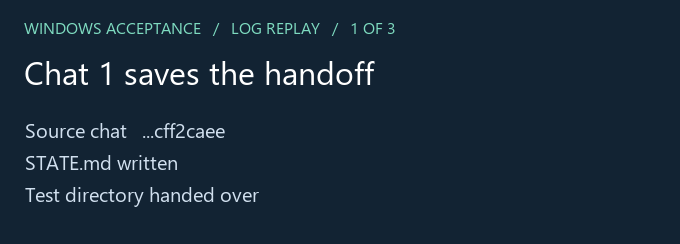

# Windows handoff acceptance test · 2026-11-18

[中文](windows-acceptance.md)

Can a fresh chat execute the next step in the same project and leave an independently verifiable result?

The GIF reconstructs events from the test record. It shows the final eight characters of each chat ID.

| Environment | Verified detail |
| --- | --- |
| Windows | Windows 11 25H2, OS build 26200.8457, checked in the test machine's registry |
| Codex CLI | Both session logs recorded `0.169.0-alpha.11.1` |
| Skill version | [7ed4cd2](https://github.com/garwin925-wq/codex-auto-handoff/tree/7ed4cd2) |
| Dispatch path | Windows App Server, one saved local project, and a dedicated test directory |

1. **Chat 1 (…cff2caee) saved the handoff.** The test driver generated a random value. The source wrote it to `STATE.md` along with the result path and a record of the transfer of write ownership. The source turn finished before dispatch.
2. **Chat 1 → Chat 2 (…857dad21).** The release helper resolved the saved project, called `thread/start`, checked the reported project ID and working directory, and sent `turn/start`. The logs showed the same working directory and distinct chat IDs. The receiver's title ended in 2.
3. **Chat 2 executed the next step.** The receiver reported checking the handoff and workspace, wrote the value to `result.txt`, and read it back. The initial prompt also included the short checkpoint snapshot. The driver independently verified that the file contained the original random value.
4. **The receipt confirmed completion.** It recorded `completed`, `error: null`, and `writerReleased: true`. The checkpoint's SHA-256 matched the receipt. The local result file's SHA-256 was `630be5333b54e9bef674777281b9f9c0f253d86290b05a76771936554114fd59`. Each reproduction uses a different random value.

**To reproduce**, create a test directory in a saved project. Give Chat 1 a new random value and ask it to save a checkpoint instructing the receiving chat to write that value to an absolute result path. Invoke `$codex-auto-handoff` in Chat 1. Check that the receiving chat has a distinct ID, confirm its project and working directory, then read the result file independently and compare it with the original value. When using the fallback, check `handoff-state/receipts/` under the Codex user directory.

This test used a deliberately chosen checkpoint. Threshold timing, desktop focus changes, and hook delivery before compaction require separate observation. See the [natural threshold observations](natural-threshold-observation.md).
