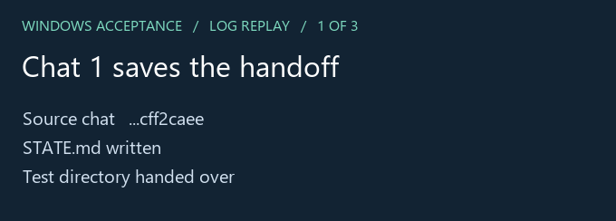

# Windows 接续验收 · 2026-11-18

[English](windows-acceptance.en.md)

**验收问题**：来源聊天交出任务后，新聊天能否在同一项目里执行下一步，并产生可独立检查的结果？

GIF 根据本次验收记录重绘。它是事件回放，未录制桌面 UI。聊天 ID 仅显示末八位。

| 环境 | 核对结果 |
| --- | --- |
| Windows | Windows 11 25H2，OS build 26200.8457（验收机注册表复核） |
| Codex CLI | 两个会话日志均记录 `0.169.0-alpha.11.1` |
| 技能版本 | [7ed4cd2](https://github.com/garwin925-wq/codex-auto-handoff/tree/7ed4cd2) |
| 入口 | Windows App Server；已保存的同一本地项目；独立验收目录 |

1. **Chat 1（…cff2caee）保存交接。** 验收器生成随机验收值，请来源聊天写入 `STATE.md`，说明目标文件和写入权已交出。来源回合结束后才发起接续。
2. **Chat 1 → Chat 2（…857dad21）。** 验收器调用发布版的派发函数；它解析已保存项目，调用 `thread/start` 并核对响应中的项目 ID 和 cwd，再发出 `turn/start`。两次会话记录的 cwd 相同。收据记下不同的来源和目标 ID，目标标题为“自动换聊验收 · 来源2”。
3. **Chat 2 执行下一步。** 接收聊天报告已核对交接文件与工作区，把验收值写入 `result.txt` 并回读。短交接的快照也随首条提示发送。验收器独立读盘，确认结果包含事先生成的随机值。
4. **核对结束状态。** 收据为 `completed`、`error: null`、`writerReleased: true`。交接文件的 SHA-256 与收据匹配，本地结果文件的 SHA-256 为 `630be5333b54e9bef674777281b9f9c0f253d86290b05a76771936554114fd59`。随机值每次不同，复测时应比较该次的期望值。

**可复测步骤**：在一个已保存的测试项目里创建临时目录。给 Chat 1 一个新的随机值，请它只写交接文件，指明由接收聊天写结果文件的绝对路径。随后在 Chat 1 调用 `$codex-auto-handoff`。核对新聊天 ID、项目及工作目录，再从聊天之外读回结果文件，比对随机值。使用备用入口时还可检查用户 Codex 目录下的 `handoff-state/receipts/`。

本次人为选择了交接点。它验证的是保存、创建、读取和执行。长聊自然达到阈值的时机、桌面自动聚焦，以及每次系统压缩前都能收到提醒，均未由这次验收验证。
